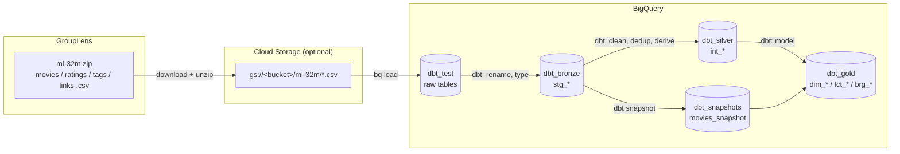
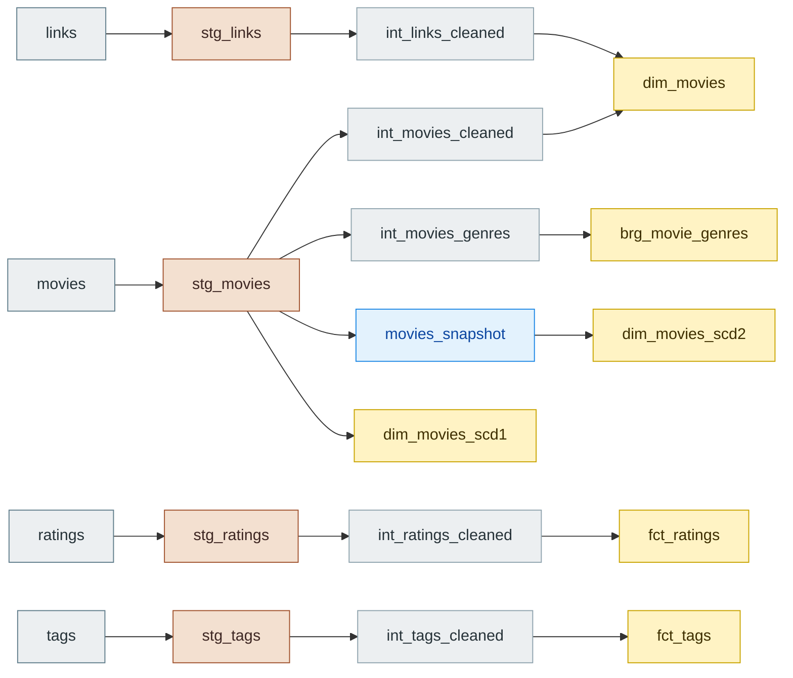
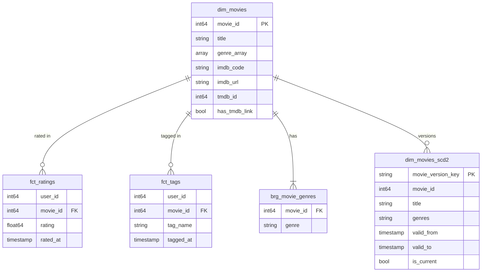
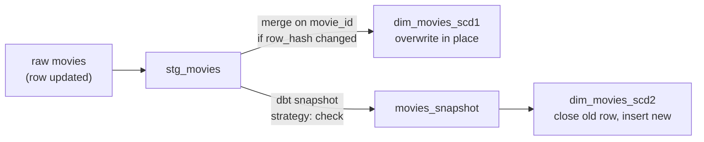

# MovieLens dbt Project (BigQuery)

An end-to-end analytics pipeline built with **dbt** on **Google BigQuery**, using the
[MovieLens 32M](https://files.grouplens.org/datasets/movielens/ml-32m-README.html) dataset.
Raw CSVs are loaded into BigQuery, then transformed through a **bronze → silver → gold**
(medallion) architecture into a star schema with data-quality tests and SCD1 / SCD2 history.

> The dbt project folder is named `netflix/` for historical reasons — the data is MovieLens.

---

## Table of contents

1. [Architecture](#architecture)
2. [Source data](#source-data)
3. [Tech stack](#tech-stack)
4. [Project structure](#project-structure)
5. [Setup](#setup)
6. [Loading raw data into BigQuery](#loading-raw-data-into-bigquery)
7. [Running dbt](#running-dbt)
8. [Model layers](#model-layers)
9. [Data model (gold)](#data-model-gold)
10. [Slowly changing dimensions (SCD1 & SCD2)](#slowly-changing-dimensions-scd1--scd2)
11. [Data quality tests](#data-quality-tests)
12. [Known issues](#known-issues)
13. [License & citation](#license--citation)

---

## Architecture



### Model lineage



You can also browse the interactive lineage graph with `dbt docs` (see [Running dbt](#running-dbt)).

---

## Source data

**MovieLens 32M** from GroupLens Research, University of Minnesota
([README](https://files.grouplens.org/datasets/movielens/ml-32m-README.html) ·
[download page](https://grouplens.org/datasets/movielens/)).

| Fact | Value |
|---|---|
| Ratings | 32,000,204 |
| Tag applications | 2,000,072 |
| Movies | 87,585 |
| Users | 200,948 (each with ≥ 20 ratings, anonymized) |
| Activity window | 1995-01-09 → 2023-10-12 |
| Generated | 2023-10-13 |

| File | Columns | Notes |
|---|---|---|
| `movies.csv` | `movieId, title, genres` | `genres` is pipe-separated, or `(no genres listed)` |
| `ratings.csv` | `userId, movieId, rating, timestamp` | 0.5–5.0 in half-star steps; timestamp = Unix seconds (UTC) |
| `tags.csv` | `userId, movieId, tag, timestamp` | free-text, user-generated |
| `links.csv` | `movieId, imdbId, tmdbId` | e.g. movie 1 → IMDb `tt0114709`, TMDB `862` |

All files are UTF-8 CSV with one header row; fields containing commas are double-quoted.

---

## Tech stack

| Tool | Version | Purpose |
|---|---|---|
| Python | 3.13 | runtime |
| [uv](https://docs.astral.sh/uv/) | latest | dependency & venv management |
| dbt-core | 1.12.x | transformations, tests, snapshots, docs |
| dbt-bigquery | 1.12.x | BigQuery adapter |
| Google BigQuery | — | warehouse |
| Google Cloud SDK (`gcloud`, `bq`, `gsutil`) | — | auth + raw data loading |

---

## Project structure

```
dbt_learn2/
├── pyproject.toml / uv.lock      # Python deps (dbt-core, dbt-bigquery)
├── README.md                     # this file
└── netflix/                      # dbt project
    ├── dbt_project.yml           # layer materializations & schemas
    ├── macros/
    │   └── generate_schema_name.sql   # use custom schema names as-is (no target prefix)
    ├── models/
    │   ├── sources.yml           # raw tables in dataset dbt_test
    │   ├── bronze/               # stg_*  : rename + type raw columns
    │   ├── silver/               # int_*  : clean, filter, dedup, derive
    │   └── gold/                 # dim_* / fct_* / brg_* : star schema
    ├── snapshots/
    │   └── movies_snapshot.yml   # SCD2 history of movies
    └── tests/
        ├── generic/              # reusable custom tests
        └── assert_*.sql          # singular (cross-model) tests
```

---

## Setup

### 1. Prerequisites

- A GCP project with the **BigQuery API** enabled
- [Google Cloud SDK](https://cloud.google.com/sdk/docs/install) installed
- [uv](https://docs.astral.sh/uv/getting-started/installation/) installed

### 2. Install dependencies

```bash
git clone <this-repo>
cd dbt_learn2
uv sync                # creates .venv with dbt-core + dbt-bigquery
uv run dbt --version
```

### 3. Authenticate to Google Cloud

```bash
gcloud auth login
gcloud auth application-default login     # used by dbt (method: oauth)
gcloud config set project <your-gcp-project>
```

### 4. Configure the dbt profile

Create `~/.dbt/profiles.yml` (Windows: `C:\Users\<you>\.dbt\profiles.yml`):

```yaml
netflix:
  target: dev
  outputs:
    dev:
      type: bigquery
      method: oauth
      project: <your-gcp-project>
      dataset: dbt_test          # default dataset; layers override this
      location: US
      threads: 4
      job_execution_timeout_seconds: 1000
      job_retries: 1
      priority: interactive
```

Check the connection:

```bash
cd netflix
uv run dbt debug
```

---

## Loading raw data into BigQuery

dbt does not ingest data — the four CSVs are loaded once into the **`dbt_test`** dataset,
which `models/sources.yml` declares as source `test_source`.

### 1. Download and unzip

```bash
curl -O https://files.grouplens.org/datasets/movielens/ml-32m.zip
unzip ml-32m.zip            # → ml-32m/movies.csv, ratings.csv, tags.csv, links.csv
```

### 2. Create the raw dataset

```bash
bq --location=US mk --dataset <your-gcp-project>:dbt_test
```

### 3. Upload to Cloud Storage (recommended for `ratings.csv`, ~850 MB)

```bash
gsutil mb -l US gs://<your-bucket>
gsutil -m cp ml-32m/*.csv gs://<your-bucket>/ml-32m/
```

### 4. Load each file with an explicit schema

Explicit schemas keep column names identical to the CSV headers, which the bronze models expect.

```bash
bq load --source_format=CSV --skip_leading_rows=1 --allow_quoted_newlines \
  dbt_test.movies  gs://<your-bucket>/ml-32m/movies.csv \
  movieId:INT64,title:STRING,genres:STRING

bq load --source_format=CSV --skip_leading_rows=1 \
  dbt_test.ratings gs://<your-bucket>/ml-32m/ratings.csv \
  userId:INT64,movieId:INT64,rating:FLOAT64,timestamp:INT64

bq load --source_format=CSV --skip_leading_rows=1 --allow_quoted_newlines \
  dbt_test.tags    gs://<your-bucket>/ml-32m/tags.csv \
  userId:INT64,movieId:INT64,tag:STRING,timestamp:INT64

bq load --source_format=CSV --skip_leading_rows=1 \
  dbt_test.links   gs://<your-bucket>/ml-32m/links.csv \
  movieId:INT64,imdbId:INT64,tmdbId:INT64
```

> Small files (`movies`, `links`, `tags`) can also be loaded straight from disk by replacing the
> `gs://…` path with the local file path, or via the BigQuery console (**Create table → Upload**).

### 5. Verify

```sql
select 'movies' t, count(*) n from dbt_test.movies  union all
select 'ratings',  count(*)   from dbt_test.ratings union all
select 'tags',     count(*)   from dbt_test.tags    union all
select 'links',    count(*)   from dbt_test.links;
-- expect 87,585 / 32,000,204 / 2,000,072 / 87,585
```

---

## Running dbt

Run everything from the `netflix/` folder:

```bash
cd netflix

uv run dbt build                       # models + snapshot + tests, in dependency order
```

Common commands:

| Command | What it does |
|---|---|
| `uv run dbt run` | build all models |
| `uv run dbt test` | run all tests |
| `uv run dbt snapshot` | capture SCD2 changes (run after bronze is refreshed) |
| `uv run dbt build --select stg_movies+` | rebuild movies and everything downstream, incl. snapshot |
| `uv run dbt build --select models/gold` | one layer only (`bronze` / `silver` / `gold`) |
| `uv run dbt test --select test_type:singular` | only the `assert_*` tests |
| `uv run dbt test --store-failures` | save failing rows to BigQuery for inspection |
| `uv run dbt run --select dim_movies_scd1 --full-refresh` | rebuild the incremental SCD1 model |
| `uv run dbt docs generate && uv run dbt docs serve` | browse docs + lineage graph at http://localhost:8080 |

---

## Model layers

Schema names come from `dbt_project.yml`; the custom `generate_schema_name` macro uses them
verbatim (e.g. `dbt_gold`, not `dbt_test_dbt_gold`). All models are materialized as **tables**
unless noted.

### Bronze — `dbt_bronze`

One-to-one with raw tables: snake_case renames and type conversion only.

| Model | Source | Transformations |
|---|---|---|
| `stg_movies` | `movies` | `movieId → movie_id` |
| `stg_links` | `links` | `imdbId → imdb_id`, `tmdbId → tmdb_id` |
| `stg_ratings` | `ratings` | Unix seconds → `rated_at` TIMESTAMP |
| `stg_tags` | `tags` | Unix seconds → `tagged_at` TIMESTAMP |

### Silver — `dbt_silver`

Business rules: cleaning, filtering, deduplication, derived columns.

| Model | Grain | Transformations |
|---|---|---|
| `int_movies_cleaned` | movie | `genres` split into `genre_array`; `(no genres listed)` → `['Unknown']` |
| `int_movies_genres` | movie × genre | genres unnested to one row each |
| `int_links_cleaned` | movie | builds `imdb_code` (`tt0114709`), `imdb_url`, `has_tmdb_link` flag |
| `int_ratings_cleaned` | user × movie | keeps ratings in 0.5–5.0; latest rating per user/movie |
| `int_tags_cleaned` | user × movie × tag × time | lowercases + trims tags, drops blanks, removes exact duplicates |

### Gold — `dbt_gold`

Star schema for analytics.

| Model | Type | Grain | Materialization |
|---|---|---|---|
| `dim_movies` | dimension | movie | table (full rebuild = SCD1) |
| `brg_movie_genres` | bridge | movie × genre | table |
| `fct_ratings` | fact | user × movie | table |
| `fct_tags` | fact | tag application | table |
| `dim_movies_scd1` | dimension, SCD1 | movie | incremental (merge) |
| `dim_movies_scd2` | dimension, SCD2 | movie version | table, from snapshot |

---

## Data model (gold)



Example query — top-rated Sci-Fi movies with at least 1,000 ratings:

```sql
select d.title, round(avg(f.rating), 2) as avg_rating, count(*) as n_ratings
from dbt_gold.fct_ratings f
join dbt_gold.dim_movies d using (movie_id)
join dbt_gold.brg_movie_genres g using (movie_id)
where g.genre = 'Sci-Fi'
group by d.title
having count(*) >= 1000
order by avg_rating desc
limit 10;
```

---

## Slowly changing dimensions (SCD1 & SCD2)

The raw `movies` table has no `updated_at` column, so changes are detected by **comparing values**
of `title` and `genres`.



| | SCD1 — `dim_movies_scd1` | SCD2 — `movies_snapshot` → `dim_movies_scd2` |
|---|---|---|
| History | none, latest value only | every version kept |
| Mechanism | incremental model, `merge` on `movie_id`, filtered by an MD5 `row_hash` | dbt snapshot, `strategy: check`, `check_cols: [title, genres]` |
| Audit column | `updated_at` | `valid_from`, `valid_to`, `is_current` |
| Deletes | old row remains | current row closed (`hard_deletes: invalidate`) |

### Try it

```sql
-- 1. change a raw record
update `<your-gcp-project>.dbt_test.movies`
set title = 'Toy Story (1995) - Remastered'
where movieId = 1;
```

```bash
# 2. propagate (bronze → snapshot → gold)
uv run dbt build --select stg_movies+
```

```sql
-- 3. SCD2: old version closed, new version current
select movie_id, title, valid_from, valid_to, is_current
from dbt_gold.dim_movies_scd2
where movie_id = 1
order by valid_from;

-- SCD1: single row, overwritten
select movie_id, title, updated_at
from dbt_gold.dim_movies_scd1
where movie_id = 1;
```

> **Important:** a snapshot only records changes that happen *between* runs — the first run is the
> baseline. The `dbt_snapshots` dataset cannot be rebuilt from source, so never drop it.

---

## Data quality tests

~70 tests run with `uv run dbt test`. Bronze tests on raw quirks use `severity: warn` (report,
don't fail); silver and gold tests are errors.

### Built-in tests

`unique`, `not_null`, `accepted_values` (rating steps, genre list) and `relationships`
(every fact/bridge `movie_id` exists in `dim_movies`) — defined in each layer's `schema.yml`.

### Custom generic tests — `tests/generic/`

| Test | Fails when | Used on |
|---|---|---|
| `unique_combination(columns)` | a column combination is duplicated | rating/tag/genre grains |
| `is_between(min_value, max_value)` | value outside range | `rating` |
| `not_in_future` | timestamp is after now | `rated_at`, `tagged_at` |
| `matches_regex(pattern)` | string doesn't match | `imdb_code`, `imdb_url` |
| `is_clean_text` | value not lowercase + trimmed | `tag`, `tag_name` |
| `array_not_empty` | array has zero elements | `genre_array` |

### Singular tests — `tests/`

| Test | Checks |
|---|---|
| `assert_imdb_code_matches_imdb_id` | `imdb_code` encodes the full `imdb_id` |
| `assert_tmdb_flag_consistent` | `has_tmdb_link` agrees with `tmdb_id is not null` |
| `assert_bridge_matches_genre_array` | bridge row count per movie = `genre_array` length |
| `assert_dim_movies_row_count` | the links join adds or drops no movies |
| `assert_no_valid_ratings_lost` | silver filtering/dedup keeps every valid user/movie pair |
| `assert_scd2_one_current_version` | each movie has exactly one current SCD2 version |

---

## Known issues

- **IMDb code truncation** — `int_links_cleaned` uses `lpad(imdb_id, 7, '0')`. BigQuery's `lpad`
  *truncates* longer strings, so 8-digit IMDb IDs produce wrong codes/URLs.
  `assert_imdb_code_matches_imdb_id` detects this. Fix: pad only when shorter than 7 characters.
- **Tag dedup grain** — `int_tags_cleaned` partitions by `tagged_at`, so it only removes exact
  duplicates. Drop `tagged_at` from the partition if one row per user/movie/tag is wanted.
- **Genre names** — the GroupLens README lists `Children's`, but the ml-32m data uses `Children`
  and also contains `IMAX`; the accepted-values test follows the data.

---

## License & citation

The MovieLens data is provided by [GroupLens Research](https://grouplens.org/) under its own
usage license: research use is permitted, commercial or revenue-bearing use requires prior
permission, endorsement by the University of Minnesota or GroupLens may not be implied, and
publications must acknowledge the dataset. The raw data is **not** included in this repository —
download it from the source. See the
[full license](https://files.grouplens.org/datasets/movielens/ml-32m-README.html).

> F. Maxwell Harper and Joseph A. Konstan. 2015. *The MovieLens Datasets: History and Context.*
> ACM Transactions on Interactive Intelligent Systems (TiiS) 5, 4: 19:1–19:19.
> https://doi.org/10.1145/2827872
